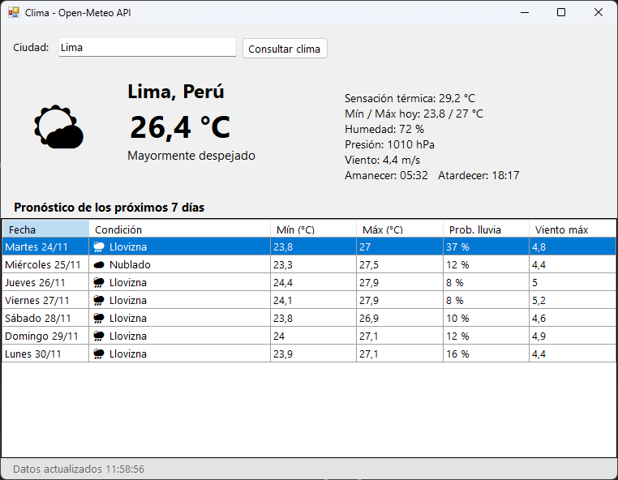
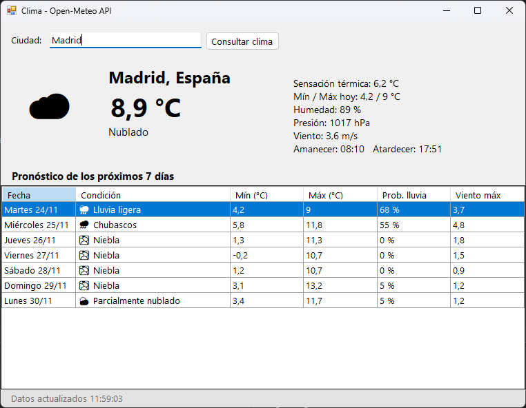
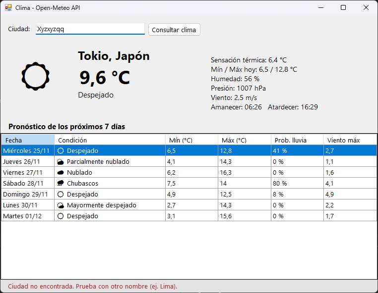

# Práctica: Consumo de API REST – Open-Meteo (.NET Framework 4.8)

## 1. API seleccionada
**Open-Meteo** (https://open-meteo.com) es una API pública y gratuita de datos meteorológicos que responde en JSON.
**No requiere API key ni registro.** Se usan dos servicios:

| Endpoint | Descripción |
|---|---|
| `GET https://geocoding-api.open-meteo.com/v1/search` | Convierte el nombre de una ciudad en latitud y longitud |
| `GET https://api.open-meteo.com/v1/forecast` | Clima actual y pronóstico de 7 días para unas coordenadas |

Parámetros principales: `name` (ciudad), `latitude`/`longitude`, `current` y `daily` (variables a obtener),
`timezone=auto`, `wind_speed_unit=ms`.

## 2. Método HTTP utilizado
**GET**: es una operación de solo lectura. Los parámetros viajan en la query string y el servidor responde
`200 OK` con un JSON. Si el código de estado no es exitoso, la aplicación muestra el error en pantalla.
El flujo usa dos solicitudes encadenadas: primero geocodificación (ciudad → coordenadas) y luego pronóstico.

## 3. Fragmento de código (`Services/OpenMeteoService.cs`)
```csharp
private async Task<T> GetAsync<T>(string url)
{
    using (HttpResponseMessage response = await _http.GetAsync(url))
    {
        string json = await response.Content.ReadAsStringAsync();

        if (!response.IsSuccessStatusCode)
            throw new Exception($"Error {(int)response.StatusCode}: {json}");

        using (var ms = new MemoryStream(Encoding.UTF8.GetBytes(json)))
            return (T)new DataContractJsonSerializer(typeof(T)).ReadObject(ms);   // JSON -> objetos C#
    }
}
```
La deserialización usa **DataContractJsonSerializer** (incluido en .NET Framework, sin paquetes NuGet) con las clases de
`Models/WeatherModels.cs` (`GeocodingResponse`, `ForecastResponse`, `CurrentData`, `DailyData`),
mapeadas con `[DataContract]` y `[DataMember(Name = "...")]`.
Los códigos de clima (WMO) que devuelve la API se traducen a texto en español y a un emoji.

## 4. Cómo se muestran los datos
Aplicación Windows Forms (`MainForm.cs`):
- **Barra superior:** cuadro de texto de ciudad y botón *Consultar clima* (también con Enter).
  Al abrir la app se consulta Lima automáticamente.
- **Panel de clima actual:** emoji de la condición, ciudad y país, temperatura, descripción, sensación térmica,
  mín/máx del día, humedad, presión, viento, amanecer y atardecer.
- **Tabla de pronóstico:** 7 días con fecha, condición, mínima, máxima, probabilidad de lluvia y viento máximo.
- **Mensajes de estado:** "Consultando…", hora de actualización o el error en rojo.





## 5. Cómo ejecutar
1. Abre `ClimaOpenMeteo.csproj` en Visual Studio (2022 o 2026).
2. Presiona **F5**. No se necesita NuGet: el proyecto solo usa librerías incluidas en .NET Framework 4.8.
3. No hace falta configurar nada más: la API no usa clave.

## 7. Repositorio
https://github.com/TigioAguirre/examenP2Progra-IV
